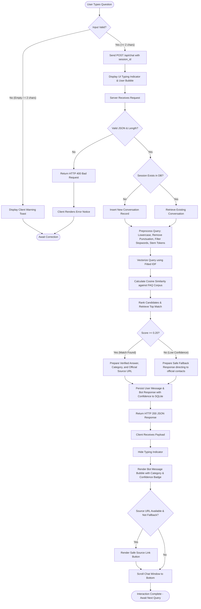

# Activity Diagram Documentation
## AI Chatbot for University Help Desk (KIET)

---

## 1. Description

The Activity Diagram models the step-by-step workflow of handling a user chat message: from client-side input validation and API dispatch, through server-side preprocessing, similarity computation, threshold branch logic, database logging, and final UI rendering.

---

## 2. Mermaid Activity Flowchart

---

## 3. Decision Points & Business Rules

1. **Client-Side Throttling:** Messages under 2 characters or exceeding 500 characters are halted before dispatching an HTTP request.
2. **Server-Side Validation:** The backend validates Content-Type and payload integrity, returning standard HTTP error codes (`400`, `415`).
3. **Institutional Protection Gate (Threshold Check):**
   - If `cosine_similarity >= 0.20`: Returns the official verified answer.
   - If `cosine_similarity < 0.20`: Directly engages the safety fallback. The system refuses to hallucinate unverified dates, fees, or faculty names.
4. **Audit Logging:** Every user message and system answer is logged to the SQLite database with timestamp and calculated confidence score.
