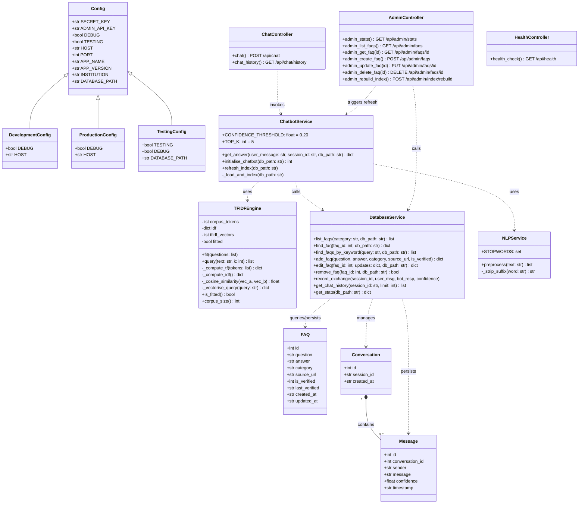

# Class Diagram Documentation
## AI Chatbot for University Help Desk (KIET)

---

## 1. Description

The Class Diagram reflects the object-oriented and modular structure of the implemented system, illustrating the domain models, service layers, configuration classes, and controller blueprints.

---

## 2. Mermaid Class Diagram

---

## 3. Structural Highlights

1. **Layered Separation:**
   - **Controllers (Routes):** Handle HTTP protocol parsing, header verification, and JSON serialization.
   - **Service Layer (`services/`):** Encapsulates core chatbot logic, NLP tokenization, similarity calculation, and database transaction abstractions.
   - **Data Layer (`models/`):** Directly executes parameterized SQLite queries with explicit foreign key constraints.
2. **Implementation Mapping Note:**
   - `Config` and `TFIDFEngine` are implemented as Python classes.
   - `ChatController`, `AdminController`, and `HealthController` represent Flask Blueprints (`routes/chat.py`, `routes/admin.py`, `routes/health.py`).
   - `FAQ`, `Conversation`, and `Message` represent relational SQLite tables and their corresponding model functions (`models/faq.py`, `models/conversation.py`), avoiding heavyweight ORM dependencies while maintaining relational integrity.
3. **Stateless Scalability:** The `TFIDFEngine` maintains an in-memory sparse index that is cleanly rebuilt whenever administrative changes occur via `refresh_index()`.
