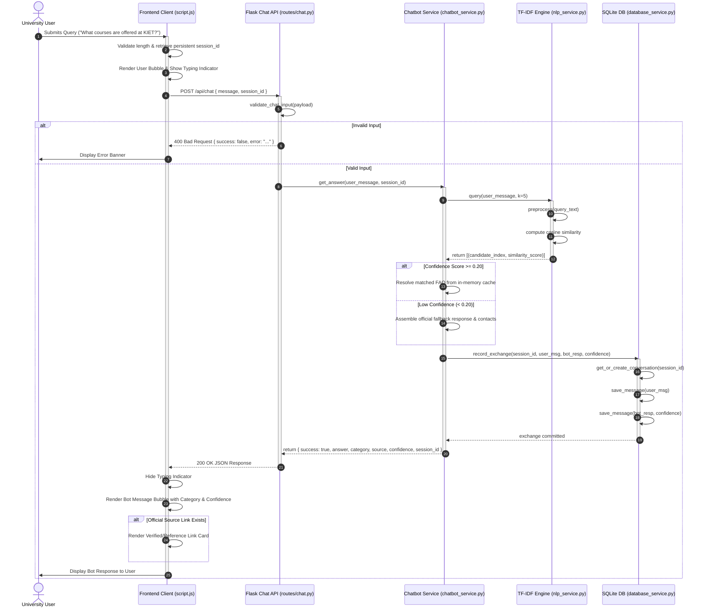

# Sequence Diagram Documentation
## AI Chatbot for University Help Desk (KIET)

---

## 1. Description

The Sequence Diagram illustrates the runtime chronology of messages and function calls exchanged between actors and software components during a query transaction.

---

## 2. Mermaid Sequence Diagram

---

## 3. Sequence Highlights

1. **Client Isolation:** The UI immediately updates with the user's bubble and animated indicator, guaranteeing responsiveness.
2. **In-Memory Query Performance:** Query vectorization and candidate comparison happen entirely in memory via `TFIDFEngine`, ensuring responsive local retrieval.
3. **Guaranteed Transactional Logging:** Regardless of whether the answer is a verified FAQ match or a safe fallback, `record_exchange()` synchronously writes both interaction halves to the SQLite database.
