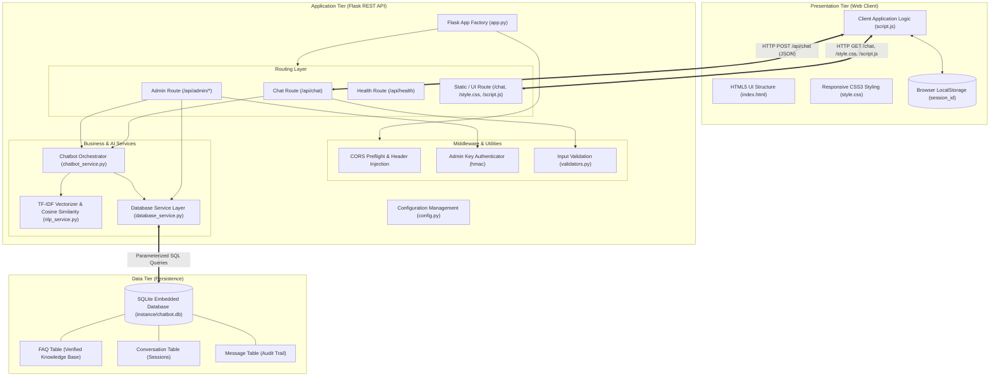
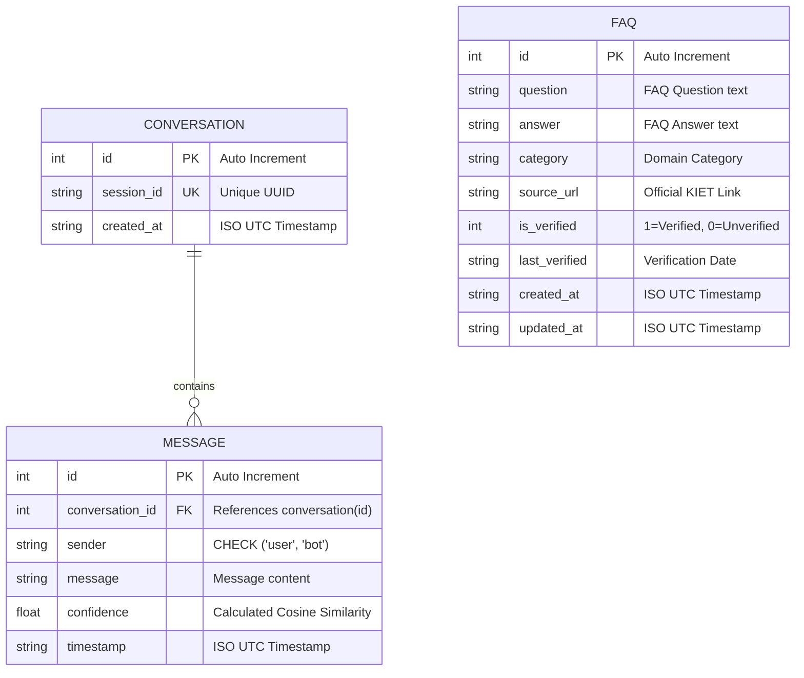

# System Architecture Documentation
## AI Chatbot for University Help Desk (KIET)

---

## 1. Architectural Overview

The **AI Chatbot for University Help Desk** is engineered using a decoupled **Three-Tier Architecture**:
1. **Presentation Tier (Client):** Responsive Single Page Application (SPA) built with HTML5, CSS3, and modern Vanilla JavaScript.
2. **Application Tier (Backend Logic):** RESTful Web Service built on Python Flask, incorporating modular Routing, Services, Validators, and an in-memory TF-IDF Natural Language Processing engine.
3. **Data Tier (Persistence):** Embedded relational SQLite database managing FAQs, session entities, and transactional chat audit logs.

---

## 2. Mermaid System Architecture Diagram

---

## 3. Database Entity Relationship (ER) Sub-diagram

---

## 4. Architectural Principles

1. **Zero External Runtime Footprint:** No external message brokers, cache servers (e.g. Redis), or container daemons are strictly required for college-level evaluation.
2. **Deterministic Information Retrieval:** Unlike generative models that risk hallucinating non-existent degrees or exam dates, TF-IDF + Cosine Similarity strictly selects answers from verified institutional rows.
3. **Defense in Depth:**
   - Parameterized SQL prevents SQL injection.
   - Text escaping prevents cross-site scripting (XSS).
   - Strict confidence cutoff (0.20) prevents out-of-domain false positives.
   - Constant-time secret checking prevents timing side-channel attacks on the admin panel.
