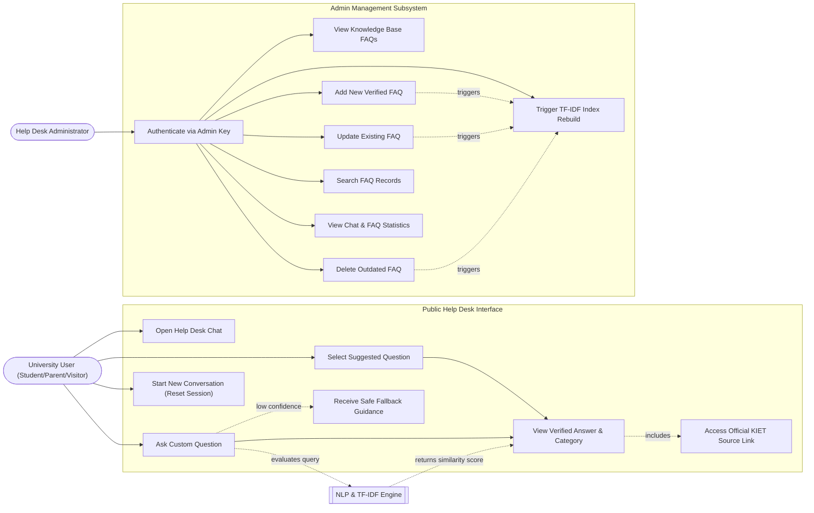

# Use Case Documentation
## AI Chatbot for University Help Desk (KIET)

---

## 1. Description

The Use Case Diagram defines the interactions between the system actors and the core capabilities provided by the **AI Chatbot for University Help Desk**.

### Identified Actors
1. **University User (Student / Parent / Visitor):** Interacts with the public chatbot interface to ask questions, view responses, read official links, and start new conversations.
2. **Help Desk Administrator:** Manages and audits the institutional FAQ database, monitors conversation statistics, and rebuilds the NLP indexing engine.
3. **NLP Search Engine (Internal System Actor):** Normalizes queries, computes TF-IDF representations, and calculates cosine similarity scores.

---

## 2. Mermaid Use Case Diagram

---

## 3. Use Case Specifications

### UC-1: Ask Custom Question
- **Primary Actor:** University User
- **Preconditions:** The user is on the chatbot interface (`/chat` or `index.html`) and the Flask server is running.
- **Main Flow:**
  1. User enters a query into the input field (e.g., "What courses are offered at KIET?").
  2. User presses Enter or clicks Send.
  3. System displays a typing indicator while processing.
  4. Backend preprocesses the text and queries the TF-IDF engine.
  5. The matched FAQ response, confidence score, and category are rendered in a bot message bubble.
  6. The exchange is logged in the SQLite database under the active session ID.
- **Alternative Flow (Low Confidence):**
  - If the query does not match any FAQ with confidence >= 0.20, the system returns a safe fallback directing the user to official KIET contact channels.

### UC-2: Manage FAQs (Admin)
- **Primary Actor:** Help Desk Administrator
- **Preconditions:** Administrator possesses the valid `ADMIN_API_KEY`.
- **Main Flow:**
  1. Admin transmits an HTTP request with header `X-Admin-Key`.
  2. System validates the key using constant-time comparison.
  3. Admin creates, updates, or deletes an FAQ record.
  4. Database updates transactionally, and the NLP engine automatically rebuilds the in-memory TF-IDF index.
